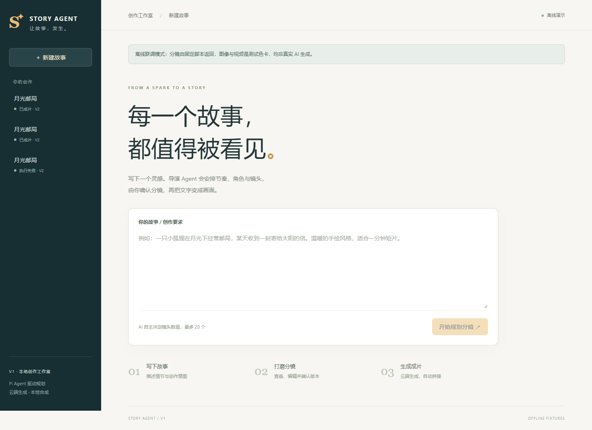

# Story2VideoAgent

把一个故事变成可编辑分镜，再通过云端 API 生成镜头，最后用 FFmpeg 拼成短片。基于 **Pi Coding Agent SDK** 的独立开源实现。

V1：故事 → Agent 自主分镜 → 人工编辑 / 版本确认 → API 生图与文生视频 → 持久化任务执行 → MP4 预览与下载。镜头数量由 AI 判断，允许 **1–20 个**。

V2 / M1：新增项目内角色库、别名、青年／老年等造型、上传／API 生成主参考图、不可变版本、角色定稿和分镜 `@` 引用。真实模式新项目默认 V2；演示模式默认 V1，可勾选 V2 体验角色流程。**M1 尚未把角色图片传入视频模型，V2 视频入口等待 M2 开放。** 取消 V2 选项可继续使用原 V1 成片流程。



## 快速启动

```powershell
git clone https://github.com/Tyysr62/Story2VideoAgent.git
cd Story2VideoAgent
npm install
if (-not (Test-Path .env.local)) { Copy-Item .env.example .env.local }
# 在本地编辑 .env.local，填入 DEEPSEEK_API_KEY 和 OPENROUTER_API_KEY
npm run build
npm start
```

打开 [本地工作室](http://127.0.0.1:4310)。首次安装从网络下载依赖与 FFmpeg；无需安装或部署生成模型。仓库固定使用 Node 22.23.4，本地 `npm` 脚本会自动使用该运行时；不修改全局 Node。Pi 要求 Node ≥22.19，旧版本全局 Node 执行安装时可能提示 engine 警告。

`.env.local`、数据库与生成素材均已加入 Git 忽略。API 密钥只由服务端读取，不能填写到前端代码或提交到仓库。默认单机单用户，服务只监听 `127.0.0.1`。

### 默认云端模型

| 用途 | 默认模型 / 配置 |
|---|---|
| 导演规划 / 后续图片理解 | DeepSeek 官方直连 `deepseek-flash`，使用 `DEEPSEEK_API_KEY` |
| 镜头预览图 | `black-forest-labs/flux-3-image-klein`，768 档 |
| 文生视频 | `minimax/hailuo-3-max`，480p，16:9，关闭音频生成 |
| 最终拼接 | 本地 FFmpeg，统一输出 1280×720 / 24fps / 静音 MP4 |

DeepSeek 能力更正（2026-10-22）：当前官方 `deepseek-flash` 对应 V4.1 Flash 1017，支持原生文本 + 图片输入。Pi 的模型能力声明包含 `image`。[官方 Vision 文档](https://api-docs.deepseek.com/guides/vision/)、[官方更新日志](https://api-docs.deepseek.com/updates/)。按用户在 2026-10-23 确认的分工，DeepSeek 能力优先直连：分镜规划已使用官方端点，后续图片理解也沿用此配置。OpenRouter 负责图像/视频生成。M1 已支持角色参考图上传及生成；自动图片理解、视频抽帧视觉检查与质量反馈尚未交付。

价格与能力以 OpenRouter 实时目录为准。2026-10-22 的公开目录快照中，默认图像约 $0.008 / 张，视频 480p 约 $0.05 / 秒；20 个各 5 秒的镜头约 $5.16，**不含分镜模型、重试及其他输入费用**。这只是目录估算，不是账单承诺。界面提供实时目录估算按钮；无法取得报价时显示未知，不伪造价格。

参考：[视频目录](https://openrouter.ai/api/v1/videos/models)、[默认图像端点](https://openrouter.ai/api/v1/images/models/black-forest-labs/flux-3-image-klein/endpoints)、[本次价格快照](docs/model-pricing-snapshot.json)。生成前会校验视频模型支持的时长、分辨率与画幅，当前默认规划提示采用 H3 Max 的 5–15 秒 / 镜头。更换视频模型时还需调整 `main.ts` 的规划时长约束，不能保证仅替换 ID 即兼容。

`DIRECTOR_PROVIDER=deepseek` 显式选择官方直连，即使同时存在 OpenRouter key，也只用 DeepSeek key 调用规划。供应商、端点、模型 ID 必须匹配；冲突配置会在本地报错。没有显式供应商和端点时，优先使用已配置的 DeepSeek key。需要用 OpenRouter 规划时，同时设置 `DIRECTOR_PROVIDER=openrouter`、`DIRECTOR_MODEL=deepseek/deepseek-v4.1-flash-1017`、`DIRECTOR_BASE_URL=https://openrouter.ai/api/v1`。

`OPENROUTER_API_KEY` 必须是普通推理密钥。管理 / Provisioning Key 可以通过认证和余额查询，但不能调用生成模型，不能用查询成功代替实际调用验收。详情见 [OpenRouter 官方管理密钥说明](https://openrouter.ai/blog/tutorials/team-spend-controls-setup/)。

### 不用密钥查看闭环

```powershell
npm run build
npm run demo
```

演示模式使用 **固定脚本分镜与 FFmpeg 色卡**，不调用模型，不产生 API 费用。页面和产物均标记模拟；它用于工程联调，不能证明生成质量。演示数据放在 `data/demo`，真实模式放在 `data/live`；如果设置了 `STORY_AGENT_DATA_DIR`，则优先使用指定目录。

## 操作顺序

### V2 / M1：角色与引用

1. 保持勾选「启用角色参考（V2）」，输入故事并规划。AI 决定镜头数量，首次规划建立角色与默认造型文字草案。
2. 在角色库编辑身份描述、名称与别名；按需添加青年／老年／换装造型。历史别名会保留，不能通过清空字段破坏旧引用。
3. 为出镜造型上传主参考图，或展开 AI 候选图入口，查看模型与报价、确认本次费用后生成。支持静态 PNG / JPEG / WebP，最多 10 MiB、4096×4096，按实际文件解码校验。演示图明确标注测试替身。
4. 图片或描述变化会建立新造型版本。点击「更新镜头引用到当前造型版本」并保存分镜；也可以在单镜头输入 `@`，选择角色及造型。引用标签可展开查看绑定版本和原图。
5. 检查参考图与描述后「确认角色定稿」。外观、参考图或全局风格变化会使旧定稿失效；仅改名保留身份和引用。未保存修改不能直接定稿，另一窗口更新会显示冲突并保留本地文本。
6. M1 到角色和引用交付为止。参考图驱动的分镜首帧、整组首帧确认和图生视频属于 M2；视觉检查与局部修复属于 M3。旧 V1 项目可显式启用 V2，原产物保留，旧执行确认撤销；切换后 M1 阶段不再生成视频。

角色图片由用户审阅，不自动保证同一身份在不同年龄阶段仍完全一致。首次 AI 规划提供默认造型，年龄阶段可手工补充；没有自动资产合并或跨项目市场。生成模型调用全部走 API，图片校验与 FFmpeg 在本地运行。

### V1：完整成片流程

1. 输入故事和风格要求，让 Agent 决定镜头数量并提交结构化草案。
2. 编辑标题、风格、镜头描述、运镜、时长和生成提示词，保存产生新版本。
3. 查询费用，确认当前版本。任何分镜修改都会使旧确认失效。
4. 点击「调用 API 生成」。按镜头依次生成图像和文生视频，再合成最终视频。
5. 查看片段、进度、执行记录，播放或下载成片。

生图目前用于独立分镜预览，**没有作为视频首帧输入**；视频使用文本提示词。V1 尚未实现图生视频、跨镜头身份验证、VLM 质量审查、自动局部修复、配音或配乐，不应宣称这些能力已经实现。

## 设计与源码入口

```text
src/
  domain/storyboard.ts      1–20 镜头 Schema、项目/任务/产物类型
  domain/characters.ts     身份、造型、不可变版本、@ 解析与稳定引用
  storage/repository.ts     SQLite、版本冲突检测、唯一任务键、事件
  storage/characters.ts    项目角色库、角色定稿清单和素材元数据
  storage/portrait-jobs.ts  独立角色生图任务及不可变请求快照
  characters/              实际图片解码、受控存储、候选图任务执行
  director/pi-director.ts   真正的 Pi AgentSession 与结构化分镜工具
  config/providers.ts      官方端点、供应商与凭据的匹配，防止跨供应商错发
  media/openrouter.ts      云端目录、报价、生图、异步视频、结果下载
  media/ffmpeg.ts           成片拼接与明确隔离的离线测试素材
  workflow/workflow.ts      确认门禁、去重、持久化执行、重启恢复
  server/                  Fastify HTTP API / 启动入口
  client/                  React 创作界面
tests/                     单元、契约、真实 HTTP / FFmpeg 联调、浏览器测试
```

Pi 只获得 `propose_storyboard` 工具，不获得 shell、文件读写或项目扩展。它负责创作决策；付费任务由确定性的执行器负责。SQLite 是业务状态来源，Pi 会话是单次内存会话，不替代业务数据库。

唯一任务键为「项目 + 分镜版本 + 任务类型 + 镜头 ID」，同一版本重复点击会复用完成产物。云端视频任务 ID 提交后立即持久化；重试或重启会优先查询已有 ID。提交超时 / 服务器异常导致结果不明时标记 `unknown`，阻止自动重复提交。需要先在 OpenRouter 核实；**V1 尚无手工核销 / 绑定未知任务的界面，不能直接点重试解决 `unknown`**。

已明确失败且没有云端任务 ID 的任务可通过再次生成人工重试，最多 3 次；已有视频 ID 的查询 / 下载恢复不受这个上限阻断，完成产物不重做。图片已返回后发生本地保存故障、视频 ID 无法落库等情况都会保守标记 `unknown`，防止重复付费。重新规划会撤销旧确认；规划和生成互斥，生成期间禁用分镜修改。修改版本后的生成属于新任务，不提供跨版本素材复用。任务串行执行，单实例运行；请勿启动多个进程共享同一数据目录。

当前约束：图像返回体最多约 40MB Base64，视频片段下载最多 256MB，单次 FFmpeg 默认 120 秒。媒体下载对外部存储域名有白名单，供应商变更存储域时可能需要适配。任务失败原因会脱敏，不回显供应商响应正文或密钥。备份时同时保存 SQLite 数据库与 `artifacts` 目录。

## 测试与验收

```powershell
npm run check
npm test
npm run build
# Windows 默认使用已安装的 Edge。没有 Edge 时先安装：
npx playwright install msedge
npm run test:e2e
# 或一次执行全部检查：
npm run verify
```

本机也可使用已安装的 Edge：

```powershell
$env:PLAYWRIGHT_CHANNEL = 'msedge'
npm run test:e2e
```

浏览器测试启动 4321（演示）与 4322（无凭据真实模式）端口，测试数据位于 `data/e2e*`。执行顺序、实际测试结果、联调修复和验收边界见 [模块交付记录](docs/delivery.md)。

成片是 H.264 MP4，预览需要支持 H.264 的浏览器。Playwright 精简 Chromium 在本机实测不含该解码器，因此 Windows 默认以完整 Edge 做真实播放验收；Linux / macOS 和 CI 默认完整 Chrome，先执行 `npx playwright install --with-deps chrome`。可用 `PLAYWRIGHT_CHANNEL` 显式切换到其他支持该编码的浏览器。不能把缺少解码器导致的失败通过跳过播放断言掩盖。

自动化测试不消耗真实 API 额度：真实 Pi HTTP 编解码、SQLite、FFmpeg 与浏览器运行；云端响应由测试服务 / Fetch 替身提供。**2026-10-23 已用官方 DeepSeek 完成文字分镜实测，得到 5 个镜头、总计 30 秒的待确认草案。OpenRouter 生图 / 视频的真实生成效果和账单仍待用户确认分镜后验收。**

## 项目来源与许可

本项目是新建的独立实现，作为对故事成片 Agent 的公开工程重建；不包含历史雇主源码、数据、资产或线上指标。Pi 通过 npm SDK 引入，请保留其 MIT 许可及依赖各自的许可说明。

ERP-AGENT 仅用于理解审批、执行与状态持久化等设计，没有复制其源码或素材。当前实现与简历中的历史项目是不同交付物，公开效果应以此仓库可复现实验为准。

本仓库自有源码采用 [MIT](LICENSE)。FFmpeg 二进制为 `ffmpeg-static` 下载的外部依赖，不纳入源码仓库；再分发二进制前请检查其构建与 LGPL/GPL 许可要求。云端模型及输出还受对应服务条款约束。
