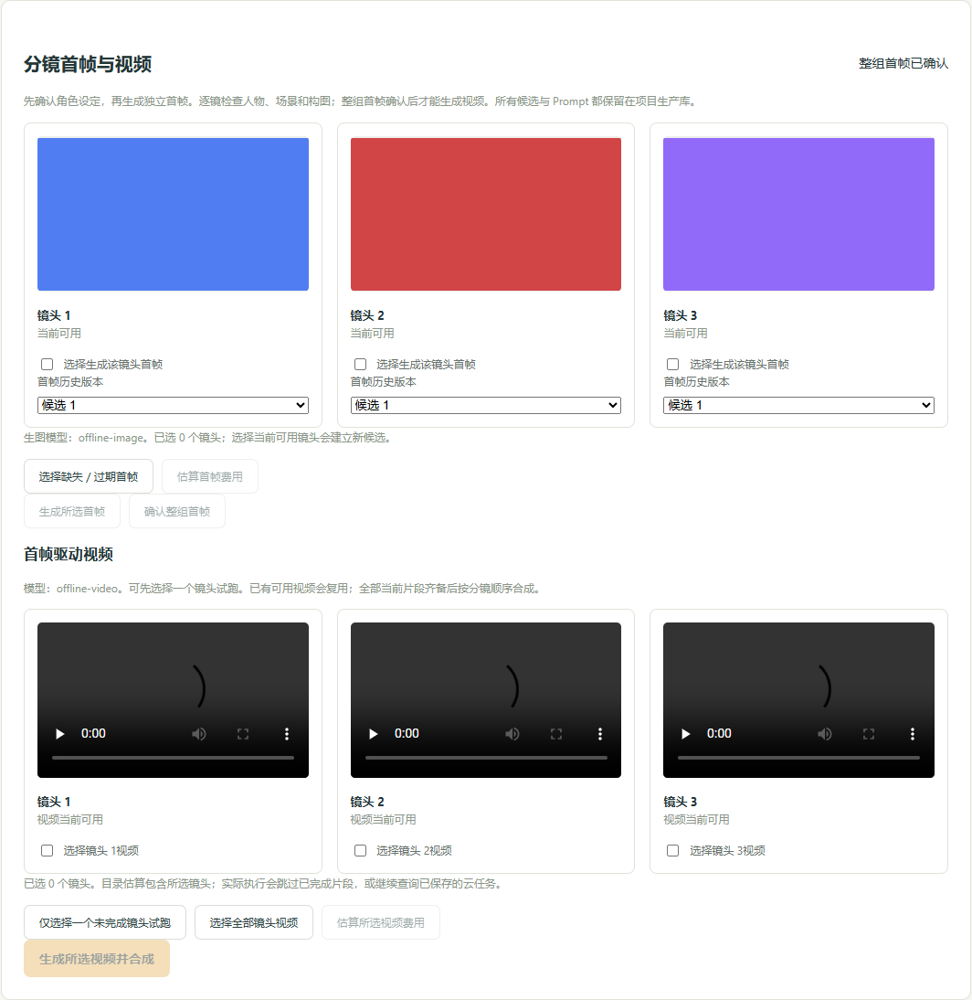
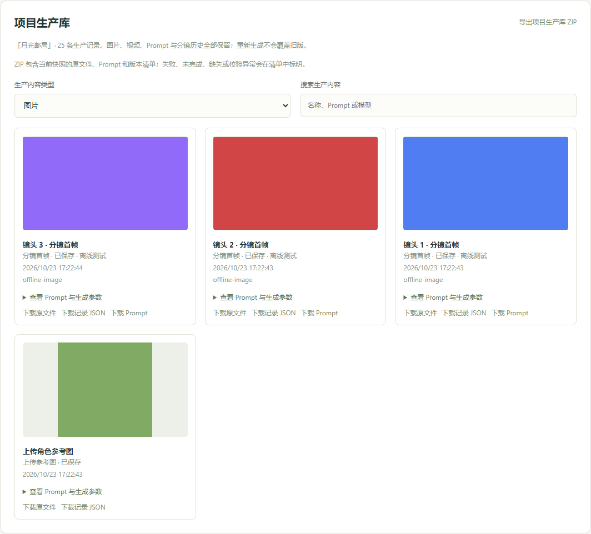

# V2 / M2 交付记录

日期：2026-10-23。M1 已由用户验收；本轮按生产归档 → 项目库／导出 → 首帧 → 视频／存储顺序开发，每段测试通过后继续下一段。

## 本轮能力

- 项目生产库：不可变分镜与 Prompt 历史，实际导演输入、角色请求、上传／生成角色图、首帧候选、视频、成片和失败／未知记录。旧项目回收数据库中可定位的现存内容，缺失的历史 Prompt 不补造。
- 分类搜索、图片／视频预览、原文件／Prompt／JSON 下载，以及流式项目 ZIP 导出。清单含角色库与历史版本、引用、模型参数、内容摘要与文件可用性；不含密钥、环境文件、数据库、诊断日志及签名 URL。
- 角色参考顺序进入 Qwen `input_references`，逐端点校验数量、1K、16:9，并固定可用端点，禁止不支持时退回纯文字生成。首帧候选不覆盖，整组确认绑定实际输入与模型配置。
- HeyGen `frame_images/first_frame` 图生视频，支持选中镜头试跑、继续已有云任务、复用有效片段及顺序合成。图生视频按参考输入计费项报价，不复用纯文生视频低价估算。
- 自有 S3 兼容桶私有上传、1 小时签名 GET URL。未配置时禁止新视频提交，但已保存云任务仍可继续查询。生成模型全部使用 API，本地只做媒体校验与 FFmpeg 合成。
- 明确失败与未知提交分开，未知输入阻止自动重提。生产前记录输出目标；重启时找回已写出但未落库的输出，作为待核实素材进入库，不通过自动重发“修复”。

## 验证与修复证据

`npm run verify` 通过：**114 项 Vitest（17 文件）、10 项完整 Edge 浏览器测试、TypeScript 和生产构建**。包含真实 SQLite、HTTP、媒体解码、FFmpeg 和 ZIP 解包；模型／对象存储使用明确替身，不消耗真实生成额度。

新断言先失败再通过：生产记录不可变／版本保留／回收、ZIP 与单项读取、首帧 API 能力／引用契约、首帧选择与确认失效、未知提交防重提、已保存云任务恢复、缺存储配置阻断、图生视频请求与报价、私有存储字节校验及完整浏览器闭环。浏览器覆盖旧 V1 播放、V2 角色、Prompt 改版与 ZIP、两次确认、成片解码和手机宽度。

独立后端与 UI 审查发现并修复三项 P2：中断后输出未自动收库、显示名改变导致真实 Prompt 与指纹不一致、角色未保存草案未锁住 M2 费用操作。针对性测试均先失败后通过，复审无新增阻塞项。另补充“已付费云任务不因暂缺对象存储配置而无法轮询”的回归。

截图为离线色卡，明确不代表真实生成质量：

## 边界

本轮不自动提交付费冒烟。真实 Qwen 参考一致性、HeyGen 首帧效果、对象存储联通和实际账单，需用户完成本地存储配置后主动发起验收。已有真实角色图由迁移回收，不重新生成。M3 的 DeepSeek 视觉检查、修复与量化评测未实施。

ZIP 是生产数据快照，不是数据库备份／一键恢复包。导出时尚未完成的云任务只导出已有输入和状态；未知任务不会伪装成已保存视频。用户自行管理对象存储生命周期；本地生产库没有自动清理逻辑。

大版本只做本地提交与服务更新，GitHub 推送需本轮用户确认。
